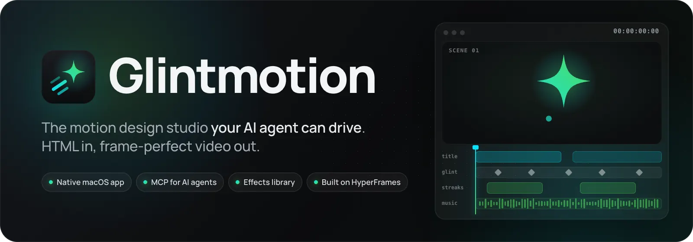
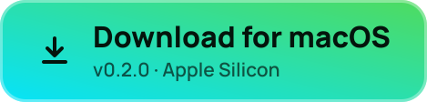
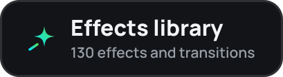
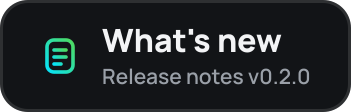
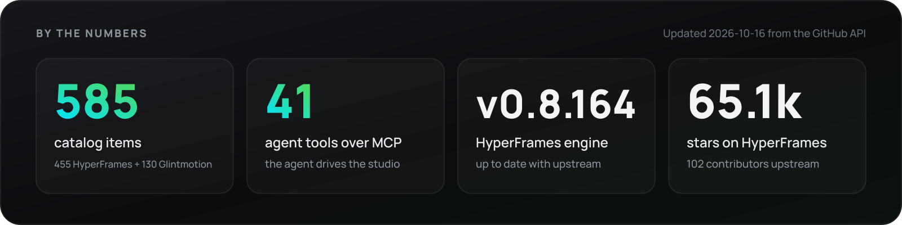
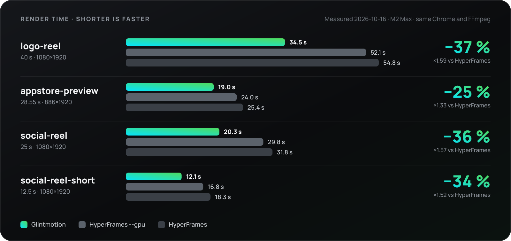
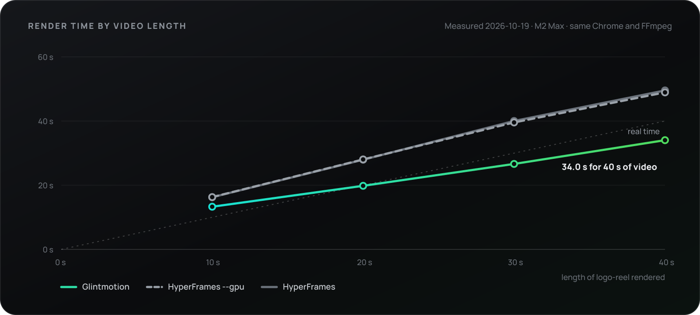
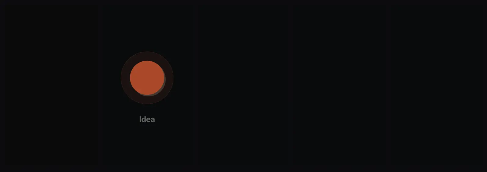

<p align="center">
  <a href="https://github.com/Soflutionltd/glintmotion/releases/latest">
    
  </a>
</p>

<p align="center">
  <a href="https://github.com/Soflutionltd/glintmotion/releases/latest"></a>
  <a href="https://github.com/Soflutionltd/glintmotion/releases"></a>
  
  
  <a href="#connecter-ton-agent"></a>
  <a href="https://github.com/Soflutionltd/glintmotion-source"></a>
  <a href="https://github.com/Soflutionltd/glintmotion-effects"></a>
</p>

<p align="center">
  <a href="https://github.com/Soflutionltd/glintmotion/releases/latest/download/Glintmotion-darwin-arm64.zip"></a>&nbsp;
  <a href="https://github.com/Soflutionltd/glintmotion-effects"></a>&nbsp;
  <a href="https://github.com/Soflutionltd/glintmotion/releases/latest"></a>
</p>

<p align="center"><a href="README.md">English</a> · <b>Français</b></p>

<br>

Tu décris une vidéo. Ton agent l'écrit en HTML, tu la regardes bouger dans le studio, tu la corriges image par image, et tu exportes une vidéo identique à l'aperçu, à l'image près.

Glintmotion est un studio macOS natif, avec un moteur de rendu réglé pour les puces Apple. Cursor, Claude Code ou n'importe quel client MCP se connecte à l'app et travaille dedans : il ouvre tes projets, écrit les scènes, parcourt la timeline, regarde les images, vérifie le mouvement et lance le rendu. Tu vois chaque changement en direct, et tu peux annuler tout le tour de l'agent en une fois.

## Points forts

<table>
  <tr>
    <td width="33%" valign="top">
      <h3>Ton agent, dans le studio</h3>
      41 outils MCP pour ouvrir, modifier, se déplacer, inspecter, vérifier et rendre. L'agent travaille dans le studio que tu regardes, pas dans un dossier caché.
    </td>
    <td width="33%" valign="top">
      <h3>Annuler en une fois</h3>
      Chaque tour de l'agent est une seule entrée de l'historique du projet. Tu l'annules en entier, ou tu vois exactement ce qui a changé depuis ta dernière modification.
    </td>
    <td width="33%" valign="top">
      <h3>Vérifié avant l'export</h3>
      Lint, chevauchements, contraste du texte, médias cassés, et une vérification du mouvement image par image qui repère les animations qui démarrent en retard, calent ou saccadent.
    </td>
  </tr>
  <tr>
    <td width="33%" valign="top">
      <h3>Bibliothèque d'effets</h3>
      123 transitions GL et des effets construits sur SplitText, MorphSVG, DrawSVG, Physics2D et CustomWiggle de GSAP. L'agent les trouve et les installe pour toi.
    </td>
    <td width="33%" valign="top">
      <h3>Séries</h3>
      Un modèle, plusieurs versions grâce à ses variables. Tu les compares toutes sur une seule planche, puis tu exportes la série d'un coup.
    </td>
    <td width="33%" valign="top">
      <h3>Images de ton app</h3>
      Filme le simulateur iOS directement dans une scène, coupé à la durée de la scène, dans la langue que tu choisis.
    </td>
  </tr>
  <tr>
    <td width="33%" valign="top">
      <h3>Prêt à publier</h3>
      Des copies Reel et Post de n'importe quel rendu : cadrées au format, encodées en HEVC, son mixé à −14 LUFS.
    </td>
    <td width="33%" valign="top">
      <h3>Rien à installer</h3>
      Le moteur, Chrome et une version LGPL de FFmpeg sont dans l'app signée. Ni Node, ni Homebrew, ni navigateur à télécharger au premier rendu.
    </td>
    <td width="33%" valign="top">
      <h3>Se met à jour seule</h3>
      Les mises à jour se téléchargent en arrière-plan. L'app redémarre quand tu fais une pause et rouvre ton projet exactement où tu en étais.
    </td>
  </tr>
</table>

## Vitesse

<p align="center">
  
</p>

<!-- speed:start -->
<p align="center">
  
</p>

<p align="center">
  
</p>

| Vidéo | Durée | Glintmotion | HyperFrames | HyperFrames `--gpu` | Temps gagné |
| --- | ---: | ---: | ---: | ---: | ---: |
| logo-reel (1080×1920) | 40 s | **34,0 s** | 49,5 s | 48,9 s | **−31 %** (−30 % face à `--gpu`) |
| appstore-preview (886×1920) | 28,6 s | **18,5 s** | 23,1 s | 23,8 s | **−20 %** (−22 % face à `--gpu`) |
| social-reel (1080×1920) | 25 s | **19,3 s** | 29,1 s | 27,4 s | **−34 %** (−30 % face à `--gpu`) |
| social-reel-short (1080×1920) | 12,5 s | **11,2 s** | 16,0 s | 16,1 s | **−30 %** (−31 % face à `--gpu`) |
| 4 s de logo-reel (`--from 10 --to 14`) | 4 s | **9,8 s** | impossible : vidéo entière | impossible : vidéo entière | **−71 %** face à la vidéo entière |

Qualité : face au rendu de HyperFrames encodé par le processeur (CRF 16), Glintmotion obtient en moyenne 46,1 dB de PSNR, et HyperFrames `--gpu` 46,4 dB. Au-dessus de 40 dB, la différence ne se voit pas.

<sub>Mesuré le 2026-10-19 sur un Apple M2 Max, 12 cœurs, 96 Go, macOS 27.0.1. Glintmotion avec le moteur 0.8.174, HyperFrames 0.8.174 depuis npm. Même Chrome et même FFmpeg pour tous, réglages par défaut, et HyperFrames une seconde fois avec `--gpu`. Trois passages par moteur, en alternance, valeur du milieu retenue ; cinq pour la courbe, qui rend logo-reel coupée à 10 s, 20 s, 30 s, 40 s. Script : [`bench-vs-hyperframes.mjs`](https://github.com/Soflutionltd/glintmotion-source/blob/main/scripts/bench-vs-hyperframes.mjs), temps bruts : [`data/bench.json`](data/bench.json).</sub>
<!-- speed:end -->

## Glintmotion face à HyperFrames

Comment Glintmotion se compare à HyperFrames, le moteur open source de HeyGen qui transforme du HTML en vidéo.

|                                        | **Glintmotion**                                                   | **HyperFrames** (open source)                                        |
| -------------------------------------- | ----------------------------------------------------------------- | -------------------------------------------------------------------- |
| Rendu de logo-reel (40 s)            | **34,0 s**                                                       | 49,5 s (48,9 s avec `--gpu`)                                  |
| Encodage sur la puce graphique         | Par défaut                                                        | Option `--gpu`                                                       |
| Rendu d'un seul passage                | `--from` / `--to`, son compris                                     | —                                                                    |
| Où tu travailles                       | Studio macOS natif, signé et notarisé                             | CLI et Studio dans le navigateur (`npx hyperframes preview`)¹        |
| Connexion de l'agent                   | Serveur MCP local, 41 outils, en direct dans le studio            | Compétences d'agent et CLI ; un MCP hébergé par HeyGen²              |
| Annuler tout un tour de l'agent        | ✅                                                                | —                                                                    |
| Vérification du mouvement image par image | ✅                                                             | —                                                                    |
| Lint, mise en page et contraste        | ✅                                                                | ✅                                                                   |
| Catalogue                              | Blocs et composants **plus** la bibliothèque Glintmotion Effects   | Blocs et composants                                                  |
| Séries de modèles et comparaison       | ✅                                                                | Variables de composition                                             |
| Prises du simulateur iOS               | ✅                                                                | —                                                                    |
| Export Reel et Post                    | ✅                                                                | —                                                                    |
| Node, Chrome et FFmpeg                 | Inclus dans l'app                                                 | Node.js 22+ et FFmpeg à installer, Chrome téléchargé                 |
| Rendu dans le cloud                    | —                                                                 | ✅ AWS Lambda, cloud HeyGen                                           |
| Windows et Linux                       | —                                                                 | ✅                                                                   |
| Langue de l'interface                  | Français pour l'instant                                           | Anglais                                                              |
| Licence                                | [PolyForm Noncommercial](https://github.com/Soflutionltd/glintmotion-source/blob/main/LICENSE.md), code source sur GitHub | Apache 2.0                                 |
| Contributions                          | Bienvenues, voir le [guide](https://github.com/Soflutionltd/glintmotion-source/blob/main/CONTRIBUTING.md) | Bienvenues                                 |

<sub>¹ HeyGen propose aussi une app HyperFrames native pour Mac et Linux, en dehors du dépôt open source ; ce tableau compare Glintmotion au projet open source. ² `mcp.heygen.com`, avec un compte HeyGen. Les chiffres ci-dessus sont mis à jour chaque semaine depuis l'API GitHub par <a href="scripts/assets.mjs"><code>scripts/assets.mjs</code></a>.</sub>

## Bibliothèque d'effets

<p align="center">
  <a href="https://github.com/Soflutionltd/glintmotion-effects"></a>
</p>

[Glintmotion Effects](https://github.com/Soflutionltd/glintmotion-effects) est un catalogue public d'effets et de transitions. Demande-en un à ton agent, ou installe-le toi-même avec la commande `glintmotion` (installée depuis **Connecter un agent**) :

```bash
glintmotion add split-headline --registry https://raw.githubusercontent.com/Soflutionltd/glintmotion-effects/main
```

Chaque contribution passe par un robot avant la relecture : pas d'accès au réseau, ni hasard ni horloge, une licence acceptée, et un vrai rendu de l'effet. La bibliothèque est gratuite pour un usage non commercial ([PolyForm Noncommercial](https://github.com/Soflutionltd/glintmotion-effects/blob/main/LICENSE.md)) ; les œuvres de tiers gardent leur propre licence.

## Connecter ton agent

1. Ouvre Glintmotion et clique sur **Connecter un agent**, en bas de la barre latérale.
2. Copie la configuration de ton agent. Pour Cursor, elle va dans `~/.cursor/mcp.json`, sous `mcpServers` :

   ```json
   {
     "glintmotion": {
       "url": "http://127.0.0.1:47821/mcp",
       "headers": { "Authorization": "Bearer <le jeton affiché dans l'app>" }
     }
   }
   ```

   Pour Claude Code, l'app te donne une seule commande `claude mcp add` à coller dans un terminal.
3. Demande une vidéo :

   > Fais une vidéo verticale de 12 secondes pour lancer mon app : un titre qui arrive mot par mot, trois cartes de fonctionnalités, et une pastille de cloche à la fin. Vérifie le mouvement, puis exporte un Reel.

Le serveur n'écoute que sur ton Mac (`127.0.0.1`) et refuse toute requête sans le jeton de l'app. Le même panneau installe la commande `glintmotion` et les compétences de l'agent.

## Installation

1. [Télécharge `Glintmotion-darwin-arm64.zip`](https://github.com/Soflutionltd/glintmotion/releases/latest/download/Glintmotion-darwin-arm64.zip).
2. Décompresse-le et glisse **Glintmotion.app** dans le dossier Applications.
3. Ouvre-la. L'app est signée et notarisée par Apple, et se tient à jour toute seule.

Il faut un Mac Apple Silicon sous macOS 13 ou plus récent. Chaque version donne son empreinte SHA-256 dans les [notes de version](https://github.com/Soflutionltd/glintmotion/releases).

## Questions fréquentes

<details>
<summary><b>Le code source est-il public ?</b></summary>
<br>
Oui, dans <a href="https://github.com/Soflutionltd/glintmotion-source">glintmotion-source</a> : tu peux le lire, construire l'app toi-même, la modifier et proposer des pull requests. Il est sous licence <a href="https://github.com/Soflutionltd/glintmotion-source/blob/main/LICENSE.md">PolyForm Noncommercial</a> : l'usage personnel et non commercial est gratuit, l'usage commercial demande une licence de Soflution Ltd (contact@soflution.com).
</details>

<details>
<summary><b>Je peux contribuer à l'app ?</b></summary>
<br>
Oui : corrections, vitesse, outils de l'agent, studio et traductions de l'interface sont les bienvenus. Lis le <a href="https://github.com/Soflutionltd/glintmotion-source/blob/main/CONTRIBUTING.md">guide de contribution</a>, puis ouvre une pull request sur glintmotion-source.
</details>

<details>
<summary><b>Quels agents fonctionnent avec ?</b></summary>
<br>
Cursor et Claude Code, pour lesquels l'app donne une configuration toute prête, et tout autre client qui gère MCP en HTTP avec un en-tête d'autorisation.
</details>

<details>
<summary><b>Je peux utiliser mes polices, mes vidéos et ma musique ?</b></summary>
<br>
Oui. Une composition est un dossier de fichiers HTML et de médias sur ton Mac. L'agent peut aussi composer une musique avec ElevenLabs, avec ta propre clé ElevenLabs.
</details>

<details>
<summary><b>Comment signaler un bug ou proposer une idée ?</b></summary>
<br>
Ouvre une <a href="https://github.com/Soflutionltd/glintmotion/issues">issue</a> avec ta version de macOS et la version de Glintmotion indiquée dans <b>À propos</b>.
</details>

<details>
<summary><b>Je peux ajouter un effet à la bibliothèque ?</b></summary>
<br>
Oui. Lis le <a href="https://github.com/Soflutionltd/glintmotion-effects/blob/main/CONTRIBUTING.md">guide de contribution</a>, puis ouvre une pull request sur Glintmotion Effects.
</details>

## Crédits

- [GSAP](https://gsap.com) de GreenSock, chargé par les compositions depuis son CDN, sous la licence GSAP Standard « No Charge ».
- [GL Transitions](https://github.com/gl-transitions/gl-transitions) (MIT), d'où viennent les transitions shader de la bibliothèque d'effets.
- [Manrope](https://github.com/googlefonts/manrope) (SIL Open Font License), la police de cette page.

Les licences du code tiers contenu dans l'app sont listées dans [LICENSE.md](https://github.com/Soflutionltd/glintmotion-source/blob/main/LICENSE.md).

La bannière en haut est une composition Glintmotion : sa source est dans [`banner/`](banner/), rendue par le moteur de Glintmotion.

<br>

<p align="center">
  <br>
  <sub>© 2026 Soflution Ltd</sub>
</p>
